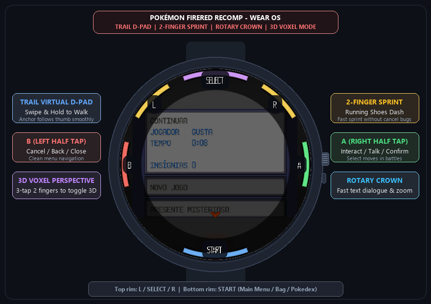

# Pokémon FireRed & Emerald - Wear OS Smartwatch Port

A native recreation of **Pokémon FireRed**, **Emerald**, and classic Gen 1/2 games running natively on **Wear OS smartwatches** (Samsung Galaxy Watch 4/5/6/7/Ultra, Google Pixel Watch 1/2/3, Xiaomi Watch 2, etc.), featuring custom touch gestures, rotary crown navigation, and real-time **3D Voxel Mode**.

<p align="center">
  
</p>

---

## ⌚ What We Ported & Built for Wear OS

We brought the classic Pokémon experience to circular smartwatch screens with a custom touch input engine, gesture recognition, and 3D rendering:

- **🕹️ Trail Virtual D-Pad**: Touch and slide anywhere on the screen to walk. The control anchor smoothly follows your thumb, keeping your field of view clear on the compact round watch display.
- **🏃 2-Finger Sprint (Running Shoes)**: Hold two fingers while walking to sprint at top speed with Running Shoes (`B`). Built with thumb roll protection so secondary accidental touches never cancel dialogue or menus.
- **🧊 Real-Time 3D Voxel Perspective**: Triple tap with 2 fingers to instantly toggle between classic 2D pixel-art and an immersive 3D voxel world with camera tilt!
- **⌚ Rotary Crown Navigation**: Spin the watch crown or touch bezel to speed through text dialogue, scroll through your Pokémon party / Bag, or zoom the 3D camera.
- **🔘 Circular Bezel Touch Controls**:
  - **`A` (Right rim)**: Interact / Talk / Confirm / Battle moves
  - **`B` (Left rim)**: Cancel / Back / Close menu
  - **`SELECT` (Top rim)**: Bicycle shortcut / Registered key item
  - **`L` / `R` (Top shoulders)**: Help / Pokédex tabs
  - **`START` (Bottom rim)**: Open main game menu / Bag / Save game
- **📸 Print / Showcase Mode**: Developer toggle (`WG.SHOW_CONTROLS_FOR_PRINT = true`) darkens the background and maintains high-contrast button rings for clean promotional captures.

---

## 🚀 How to Build & Install for Wear OS

### 1. Build the Wear OS APK
```bash
cd mobile/android
./gradlew :wear:assembleDebug
```
Output APK:
`mobile/android/wear/build/outputs/apk/debug/wear-debug.apk`

### 2. Install on Watch via ADB Wi-Fi
```bash
adb connect <WATCH_IP>:<PORT>
adb install -r mobile/android/wear/build/outputs/apk/debug/wear-debug.apk
```

### 3. ROM Setup
On first launch, the game launcher will prompt for your legally obtained ROM (`.gba` for FireRed/Emerald or `.gb`/`.gbc` for Gen 1/2). Assets are decoded and verified on first import and cached privately for subsequent launches.

---

## 📜 Credits & Acknowledgments

- Original games by **Game Freak**, **Creatures Inc.**, and **Nintendo**.
- Reverse engineering and disassembly by the [pret](https://github.com/pret) team ([pokered](https://github.com/pret/pokered), [pokeruby](https://github.com/pret/pokeruby), [pokeemerald](https://github.com/pret/pokeemerald), [pokefirered](https://github.com/pret/pokefirered)).
- LÖVE2D reimplementation based on the [Gen1Recomp](https://github.com/bryanthaboi/gen1recomp) engine.
